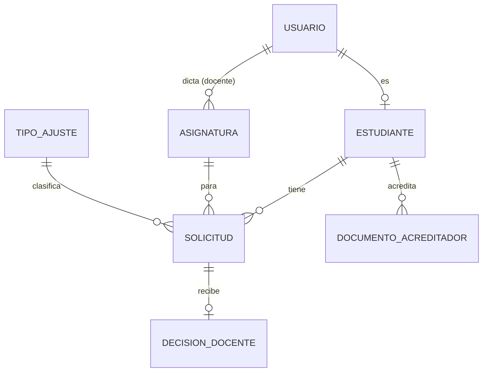

# Design Document

## Overview

Este documento describe el diseño técnico del Sistema de Gestión de Ajustes Razonables para la Oficina de Bienestar Universitario. Implementa los requisitos RF1 a RF51 y RNF1 a RNF11 de `requirements.md` con la pila fijada en el D0: Python 3.11+, FastAPI, frontend HTML y JavaScript simple, SQLite, Git y GitHub.

### Decisiones de diseño principales

1. **Monolito modular en capas.** Una sola aplicación FastAPI con las capas Model → Repository → Service → Controller → Views. Para el volumen esperado (una oficina, un semestre) no se justifica separar servicios.
2. **Prevalece el alcance (DA1).** Se implementan la validación del Número CONADIS, la carga del Documento Acreditador y el correo al Docente. Los dos servicios externos (CONADIS y correo) están detrás de interfaces (`ValidadorConadis`, `Notificador`) con una implementación **real** y una **simulada** para desarrollo y pruebas.
3. **Solo la Oficina cambia el Estado (DA2).** La decisión del Docente se guarda aparte (`decision_docente`) y no modifica el Estado. No existe el Estado "rechazada".
4. **El Docente ve lo mínimo (DA3).** Solo Solicitudes de sus Asignaturas en Estado evaluada, aprobada o implementada, sin datos de discapacidad.
5. **Sin servidor MCP ni modelo de lenguaje (DA4).** El D0 no los incluye.
6. **Cifrado a nivel de campo.** El Número CONADIS, el Tipo de Discapacidad y los Documentos Acreditadores se cifran antes de guardarse (RNF6). Filtros y totales usan solo columnas no cifradas.
7. **Gráfico de barras sin librería externa**, con una tabla de datos equivalente para lectores de pantalla.
8. **Componentes accesibles propios** (calendario y selector de Asignaturas) con patrones WAI-ARIA, sin librerías de terceros.

## Architecture

### Capas

```mermaid
flowchart TB
    V[Views<br/>páginas HTML + JS en static/]
    C[Controller<br/>routers FastAPI + dependencias de seguridad]
    S[Service<br/>EstudianteService, SolicitudService, ReporteService]
    P[Puertos y utilidades<br/>ValidadorConadis, Notificador, AlmacenDocumentos, Cifrador]
    R[Repository<br/>repositorios SQL]
    M[Model<br/>entidades, enumeraciones y DTOs en dominio/]
    DB[(SQLite)]
    FS[(Carpeta de documentos cifrados)]
    V -->|HTTPS / JSON| C --> S
    S --> R --> DB
    S --> P
    P --> FS
    C -.usa.-> M
    S -.usa.-> M
    R -.usa.-> M
```



| Capa | Responsabilidad | Carpeta |
|---|---|---|
| Model | Entidades, enumeraciones y DTOs; sin dependencias de HTTP ni SQL | `app/dominio/` |
| Repository | Acceso a SQLite con `sqlite3` y consultas parametrizadas | `app/repositorios/` |
| Service | Reglas de negocio (Estados, pendientes, totales, visibilidad por rol) | `app/servicios/` |
| Controller | Routers HTTP, validación de entrada con Pydantic, control por rol, traducción de errores | `app/routers/`, `app/seguridad.py` |
| Views | Páginas HTML con JavaScript simple | `static/` |

Cada capa solo llama a la inmediatamente inferior. Los servicios no conocen HTTP.

### Despliegue

- Un proceso `uvicorn` detrás del servidor web de la universidad (por ejemplo, Nginx), que termina TLS 1.2 o superior (RNF5) y restringe el acceso a los rangos IP de la red universitaria. Si el equipo no controla ese servidor, se usa `uvicorn` con certificado propio dentro de la red.
- La configuración se lee de variables de entorno (RNF11):

| Variable | Uso |
|---|---|
| `DB_RUTA` | Ruta del archivo SQLite |
| `DOCUMENTOS_RUTA` | Carpeta de documentos cifrados |
| `CLAVE_CIFRADO` | Clave Fernet de campos y documentos |
| `SECRETO_SESION` | Firma de la cookie de sesión |
| `CONADIS_MODO` | `activo` o `simulado` |
| `CONADIS_URL`, `CONADIS_CREDENCIAL` | Acceso al registro nacional (por definir) |
| `CORREO_MODO` | `activo` o `simulado` |
| `SMTP_HOST`, `SMTP_USUARIO`, `SMTP_CLAVE` | Servidor de correo institucional |

### Dependencias adicionales a la pila del D0

| Paquete | Para qué | Justificación |
|---|---|---|
| `cryptography` (Fernet) | Cifrado de campos y documentos | RNF6; la biblioteca estándar no ofrece cifrado simétrico |
| `pytest`, `hypothesis` | Pruebas unitarias y de propiedades | Verificación de los RF |
| `playwright`, `axe-core` | Pruebas de teclado y accesibilidad | RNF1, RNF2 |
| `httpx` | Cliente HTTP para el script de carga y el validador real | RNF4, RF6–RF8 |

Las contraseñas se guardan con `hashlib.scrypt` (biblioteca estándar).

### Estructura del proyecto

```
app/
  main.py                 # crea la app FastAPI, monta routers y archivos estáticos
  config.py               # lectura de variables de entorno
  seguridad.py            # sesión, scrypt, dependencias por rol
  dominio/                # MODEL
    modelos.py            # entidades, enumeraciones y DTOs
    errores.py            # excepciones de dominio
  repositorios/           # REPOSITORY
    db.py                 # conexión y creación del esquema
    usuarios.py
    estudiantes.py
    solicitudes.py
    catalogos.py
  servicios/              # SERVICE
    estudiantes.py
    solicitudes.py
    reportes.py
  puertos/
    conadis.py            # ValidadorConadis: Real | Simulado
    notificador.py        # Notificador: Smtp | Simulado
  almacen.py              # AlmacenDocumentos (disco, cifrado)
  cifrado.py              # Cifrador (Fernet)
  routers/                # CONTROLLER
    auth.py
    estudiantes.py
    solicitudes.py
    docente.py
    reportes.py
static/                   # VIEWS
  css/estilos.css
  js/calendario.js
  js/selector-asignaturas.js
  js/anuncios.js
  login.html  oficina-estudiantes.html  solicitud.html
  oficina-pendientes.html  mis-solicitudes.html  docente.html  reporte.html
tests/
  unit/  properties/  integracion/  accesibilidad/
datos/semilla_simulada.py # datos de prueba simulados (RNF9)
datos/carga_inicial.py    # cuentas de Docentes y Oficina, Asignaturas (DA5)
```

## Data Models

### Diagrama entidad-relación



### DDL (SQLite)

```sql
PRAGMA foreign_keys = ON;

CREATE TABLE usuario (
    id                   INTEGER PRIMARY KEY AUTOINCREMENT,
    codigo_institucional TEXT    NOT NULL UNIQUE,
    correo_institucional TEXT    NOT NULL UNIQUE,
    nombre_completo      TEXT    NOT NULL,
    rol                  TEXT    NOT NULL CHECK (rol IN ('oficina','estudiante','docente')),
    hash_contrasena      TEXT    NOT NULL,
    contrasena_temporal  INTEGER NOT NULL DEFAULT 0 CHECK (contrasena_temporal IN (0,1)),
    activo               INTEGER NOT NULL DEFAULT 1 CHECK (activo IN (0,1))
);

CREATE TABLE estudiante (
    id                        INTEGER PRIMARY KEY AUTOINCREMENT,
    usuario_id                INTEGER NOT NULL UNIQUE REFERENCES usuario(id),
    tipo_discapacidad_cifrado BLOB    NOT NULL,
    numero_conadis_cifrado    BLOB    NOT NULL,
    conadis_verificado        INTEGER NOT NULL DEFAULT 0 CHECK (conadis_verificado IN (0,1)),
    registrado_por            INTEGER NOT NULL REFERENCES usuario(id),
    registrado_en             TEXT    NOT NULL
);

CREATE TABLE asignatura (
    id         INTEGER PRIMARY KEY AUTOINCREMENT,
    codigo     TEXT    NOT NULL UNIQUE,
    nombre     TEXT    NOT NULL,
    docente_id INTEGER NOT NULL REFERENCES usuario(id),
    semestre   TEXT    NOT NULL
);

CREATE TABLE tipo_ajuste (
    id     INTEGER PRIMARY KEY AUTOINCREMENT,
    nombre TEXT    NOT NULL UNIQUE
);

CREATE TABLE solicitud (
    id              INTEGER PRIMARY KEY AUTOINCREMENT,
    estudiante_id   INTEGER NOT NULL REFERENCES estudiante(id),
    asignatura_id   INTEGER NOT NULL REFERENCES asignatura(id),
    tipo_ajuste_id  INTEGER NOT NULL REFERENCES tipo_ajuste(id),
    fecha_requerida TEXT    NOT NULL,
    estado          TEXT    NOT NULL
        CHECK (estado IN ('recibida','evaluada','observada','aprobada','implementada')),
    semestre        TEXT    NOT NULL,
    creado_por      INTEGER NOT NULL REFERENCES usuario(id),
    creado_en       TEXT    NOT NULL
);
CREATE INDEX ix_solicitud_estado_estudiante ON solicitud (estado, estudiante_id);
CREATE INDEX ix_solicitud_estado_asignatura ON solicitud (estado, asignatura_id);
CREATE INDEX ix_solicitud_semestre_tipo     ON solicitud (semestre, tipo_ajuste_id);

CREATE TABLE decision_docente (
    id           INTEGER PRIMARY KEY AUTOINCREMENT,
    solicitud_id INTEGER NOT NULL UNIQUE REFERENCES solicitud(id),
    docente_id   INTEGER NOT NULL REFERENCES usuario(id),
    decision     TEXT    NOT NULL CHECK (decision IN ('aprueba','rechaza')),
    comentario   TEXT,
    decidido_en  TEXT    NOT NULL
);

CREATE TABLE documento_acreditador (
    id             INTEGER PRIMARY KEY AUTOINCREMENT,
    estudiante_id  INTEGER NOT NULL REFERENCES estudiante(id),
    tipo           TEXT    NOT NULL CHECK (tipo IN ('conadis','medico')),
    ruta_cifrada   TEXT    NOT NULL,
    tamano_bytes   INTEGER NOT NULL CHECK (tamano_bytes > 0 AND tamano_bytes <= 5242880),
    subido_por     INTEGER NOT NULL REFERENCES usuario(id),
    subido_en      TEXT    NOT NULL
);
```

Semilla de `tipo_ajuste`: tiempo adicional en evaluaciones, materiales en formato accesible, intérprete de lengua de señas peruana, aula en primer piso, mobiliario adaptado, acompañamiento en laboratorio.

## Components and Interfaces

### Model (`app/dominio/modelos.py`)

```python
from dataclasses import dataclass
from datetime import date, datetime
from enum import StrEnum

class Rol(StrEnum):
    OFICINA = "oficina"
    ESTUDIANTE = "estudiante"
    DOCENTE = "docente"

class EstadoSolicitud(StrEnum):
    RECIBIDA = "recibida"
    EVALUADA = "evaluada"
    OBSERVADA = "observada"
    APROBADA = "aprobada"
    IMPLEMENTADA = "implementada"

class Decision(StrEnum):
    APRUEBA = "aprueba"
    RECHAZA = "rechaza"

class ResultadoConadis(StrEnum):
    COINCIDE = "coincide"
    NO_COINCIDE = "no_coincide"
    NO_DISPONIBLE = "no_disponible"

ESTADOS_PENDIENTES: frozenset[EstadoSolicitud] = frozenset(EstadoSolicitud) - {EstadoSolicitud.IMPLEMENTADA}
ESTADOS_VISIBLES_DOCENTE: frozenset[EstadoSolicitud] = frozenset(
    {EstadoSolicitud.EVALUADA, EstadoSolicitud.APROBADA, EstadoSolicitud.IMPLEMENTADA}
)

@dataclass(frozen=True)
class Usuario:
    id: int
    codigo_institucional: str
    correo_institucional: str
    nombre_completo: str
    rol: Rol
    contrasena_temporal: bool

@dataclass(frozen=True)
class Estudiante:
    id: int
    usuario_id: int
    nombre_completo: str
    tipo_discapacidad: str          # descifrado solo para Oficina y el propio Estudiante
    numero_conadis: str             # idem
    conadis_verificado: bool

@dataclass(frozen=True)
class Asignatura:
    id: int
    codigo: str
    nombre: str
    docente_id: int
    semestre: str

@dataclass(frozen=True)
class Solicitud:
    id: int
    estudiante_id: int
    asignatura_id: int
    tipo_ajuste_id: int
    fecha_requerida: date
    estado: EstadoSolicitud
    semestre: str
    creado_por: int
    creado_en: datetime

@dataclass(frozen=True)
class DecisionDocente:
    solicitud_id: int
    docente_id: int
    decision: Decision
    comentario: str | None
    decidido_en: datetime

# DTOs de entrada y salida
@dataclass(frozen=True)
class NuevoEstudiante:
    nombre_completo: str
    codigo_institucional: str
    correo_institucional: str
    tipo_discapacidad: str
    numero_conadis: str

@dataclass(frozen=True)
class RegistroEstudiante:
    estudiante: Estudiante
    contrasena_temporal: str        # se devuelve una sola vez (RF5)

@dataclass(frozen=True)
class NuevaSolicitud:
    estudiante_id: int | None       # ignorado si el actor es Estudiante (RF16)
    tipo_ajuste_id: int
    asignatura_ids: list[int]
    fecha_requerida: date

@dataclass(frozen=True)
class ResultadoCambio:
    solicitud: Solicitud
    correo_enviado: bool | None     # None si el nuevo Estado no es aprobada
    aviso: str | None               # texto de RF25 si falló el correo

@dataclass(frozen=True)
class VistaDocente:
    solicitud_id: int
    estudiante: str
    asignatura: str
    tipo_ajuste: str
    estado: EstadoSolicitud
    decision: Decision | None

@dataclass(frozen=True)
class ReporteSemestral:
    semestre: str
    por_tipo_ajuste: dict[str, int]
    por_estado: dict[EstadoSolicitud, int]
```

### Repository (`app/repositorios/`)

```python
from typing import Protocol

class UsuarioRepo(Protocol):
    def por_identificador(self, identificador: str) -> tuple[Usuario, str] | None: ...  # (usuario, hash)
    def crear(self, nombre: str, codigo: str, correo: str, rol: Rol, hash_contrasena: str, temporal: bool) -> Usuario: ...
    def existe_codigo(self, codigo: str) -> bool: ...
    def cambiar_contrasena(self, usuario_id: int, hash_contrasena: str) -> None: ...

class EstudianteRepo(Protocol):
    def crear(self, usuario_id: int, tipo_cifrado: bytes, numero_cifrado: bytes, verificado: bool, registrado_por: int) -> int: ...
    def por_id(self, estudiante_id: int) -> Estudiante | None: ...
    def por_usuario(self, usuario_id: int) -> Estudiante | None: ...
    def guardar_documento(self, estudiante_id: int, tipo: str, ruta: str, tamano: int, subido_por: int) -> None: ...

class CatalogoRepo(Protocol):
    def asignaturas(self, semestre: str) -> list[Asignatura]: ...
    def asignaturas_por_ids(self, ids: list[int]) -> list[Asignatura]: ...
    def tipos_ajuste(self) -> list[tuple[int, str]]: ...

class SolicitudRepo(Protocol):
    def crear_varias(self, solicitudes: list[NuevaFilaSolicitud]) -> list[Solicitud]: ...  # una transacción
    def por_id(self, solicitud_id: int) -> Solicitud | None: ...
    def actualizar_estado(self, solicitud_id: int, nuevo: EstadoSolicitud) -> Solicitud: ...
    def pendientes(self, estudiante_id: int | None, asignatura_id: int | None) -> list[Solicitud]: ...
    def de_estudiante(self, estudiante_id: int) -> list[Solicitud]: ...
    def de_docente(self, docente_id: int, asignatura_id: int | None, estados: frozenset[EstadoSolicitud]) -> list[VistaDocente]: ...
    def totales_por_tipo(self, semestre: str) -> dict[str, int]: ...
    def totales_por_estado(self, semestre: str) -> dict[EstadoSolicitud, int]: ...
    def guardar_decision(self, d: DecisionDocente) -> DecisionDocente: ...  # reemplaza la anterior
```

Todas las consultas usan parámetros (`?`), nunca concatenación de texto.

### Service (`app/servicios/`)

```python
class EstudianteService:
    def __init__(self, usuarios: UsuarioRepo, estudiantes: EstudianteRepo, validador: ValidadorConadis,
                 almacen: AlmacenDocumentos, cifrador: Cifrador) -> None: ...
    def registrar(self, datos: NuevoEstudiante, actor: Usuario) -> RegistroEstudiante: ...
    def adjuntar_documento(self, estudiante_id: int, tipo: str, pdf: bytes, actor: Usuario) -> None: ...
    def obtener(self, estudiante_id: int, actor: Usuario) -> Estudiante: ...

class SolicitudService:
    def __init__(self, solicitudes: SolicitudRepo, catalogos: CatalogoRepo, estudiantes: EstudianteRepo,
                 notificador: Notificador, reloj: Callable[[], datetime]) -> None: ...
    def registrar(self, datos: NuevaSolicitud, actor: Usuario) -> list[Solicitud]: ...
    def obtener(self, solicitud_id: int, actor: Usuario) -> Solicitud: ...
    def cambiar_estado(self, solicitud_id: int, nuevo: EstadoSolicitud, actor: Usuario) -> ResultadoCambio: ...
    def pendientes(self, estudiante_id: int | None, asignatura_id: int | None) -> list[Solicitud]: ...
    def de_estudiante(self, actor: Usuario) -> list[Solicitud]: ...
    def de_docente(self, actor: Usuario, asignatura_id: int | None) -> list[VistaDocente]: ...
    def registrar_decision(self, solicitud_id: int, decision: Decision, comentario: str | None,
                           actor: Usuario) -> DecisionDocente: ...

class ReporteService:
    def __init__(self, solicitudes: SolicitudRepo) -> None: ...
    def semestral(self, semestre: str) -> ReporteSemestral: ...
```

Reglas clave:

- **Registro de Estudiante (RF1–RF9):** valida formato (código y Número CONADIS de 8 dígitos), consulta `ValidadorConadis` (máximo 10 s), y crea usuario y estudiante en una sola transacción. El código institucional es único.
- **Registro de Solicitud (RF13–RF18):** si el actor es Estudiante, `estudiante_id` se toma de la sesión; si es Oficina, es obligatorio y debe existir. Se crea una Solicitud por Asignatura con Estado `recibida` y el semestre vigente; la operación es atómica.
- **Cambio de Estado (RF20–RF25):** la Oficina elige uno de los cinco Estados; otro valor se rechaza. Si el nuevo Estado es `aprobada` y antes no lo era, se llama a `Notificador.solicitud_aprobada`. Un fallo del correo no revierte el cambio.
- **Pendientes (RF26–RF30):** `estado != 'implementada'`, con filtros combinables.
- **Vista del Docente (RF36–RF37, RNF8):** solo Asignaturas del Docente con Estados de `ESTADOS_VISIBLES_DOCENTE`; nunca datos de discapacidad.
- **Decisión del Docente (RF38–RF40):** una decisión por Solicitud; no cambia el Estado.
- **Reporte (RF31–RF34):** `GROUP BY tipo_ajuste_id` y `GROUP BY estado` del semestre pedido.

### Puertos y utilidades

```python
class ValidadorConadis(Protocol):
    def verificar(self, numero: str) -> ResultadoConadis: ...

class Notificador(Protocol):
    def solicitud_aprobada(self, docente: Usuario, estudiante: str, tipo_ajuste: str, asignatura: str) -> None: ...

class AlmacenDocumentos:
    def guardar(self, estudiante_id: int, pdf: bytes) -> tuple[str, int]: ...   # (ruta, tamaño); valida %PDF- y ≤ 5 MB
    def leer(self, ruta: str) -> bytes: ...

class Cifrador:
    def __init__(self, clave: bytes) -> None: ...
    def cifrar(self, texto: str) -> bytes: ...
    def descifrar(self, dato: bytes) -> str: ...
```

| Puerto | Variable | Modo `activo` | Modo `simulado` |
|---|---|---|---|
| `ValidadorConadis` | `CONADIS_MODO` | Consulta el registro nacional con `CONADIS_URL`. **Sin implementar hasta definir el acceso** | Acepta los números de la semilla (p. ej. "00123456"), rechaza "99999999" y permite simular `no_disponible` |
| `Notificador` | `CORREO_MODO` | Envía por SMTP institucional | Guarda el mensaje en memoria y en el log, sin datos sensibles |

El modo `simulado` es solo para desarrollo y pruebas.

### Controller (`app/routers/` y `app/seguridad.py`)

```python
def usuario_actual(request: Request) -> Usuario: ...
def requiere_rol(*roles: Rol) -> Callable[..., Usuario]: ...

# routers/estudiantes.py
@router.post("/api/estudiantes", status_code=201)
def registrar_estudiante(body: NuevoEstudianteIn, actor: Usuario = Depends(requiere_rol(Rol.OFICINA))) -> RegistroEstudianteOut: ...
@router.post("/api/estudiantes/{estudiante_id}/documento", status_code=201)
def adjuntar_documento(estudiante_id: int, archivo: UploadFile, actor: Usuario = Depends(requiere_rol(Rol.OFICINA))) -> None: ...
@router.get("/api/estudiantes/{estudiante_id}")
def obtener_estudiante(estudiante_id: int, actor: Usuario = Depends(usuario_actual)) -> EstudianteOut: ...

# routers/solicitudes.py
@router.post("/api/solicitudes", status_code=201)
def registrar_solicitud(body: NuevaSolicitudIn, actor: Usuario = Depends(requiere_rol(Rol.ESTUDIANTE, Rol.OFICINA))) -> list[SolicitudOut]: ...
@router.get("/api/solicitudes/{solicitud_id}")
def obtener_solicitud(solicitud_id: int, actor: Usuario = Depends(requiere_rol(Rol.OFICINA, Rol.ESTUDIANTE))) -> SolicitudOut: ...
@router.patch("/api/solicitudes/{solicitud_id}/estado")
def cambiar_estado(solicitud_id: int, body: CambioEstadoIn, actor: Usuario = Depends(requiere_rol(Rol.OFICINA))) -> ResultadoCambioOut: ...
@router.get("/api/solicitudes/pendientes")
def pendientes(estudiante_id: int | None = None, asignatura_id: int | None = None,
               actor: Usuario = Depends(requiere_rol(Rol.OFICINA))) -> list[SolicitudOut]: ...
@router.get("/api/mis-solicitudes")
def mis_solicitudes(actor: Usuario = Depends(requiere_rol(Rol.ESTUDIANTE))) -> list[SolicitudOut]: ...

# routers/docente.py
@router.get("/api/docente/solicitudes")
def solicitudes_docente(asignatura_id: int | None = None, actor: Usuario = Depends(requiere_rol(Rol.DOCENTE))) -> list[VistaDocenteOut]: ...
@router.post("/api/docente/solicitudes/{solicitud_id}/decision")
def registrar_decision(solicitud_id: int, body: DecisionIn, actor: Usuario = Depends(requiere_rol(Rol.DOCENTE))) -> DecisionOut: ...

# routers/reportes.py
@router.get("/api/reportes/semestral")
def reporte_semestral(semestre: str, actor: Usuario = Depends(requiere_rol(Rol.OFICINA))) -> ReporteSemestralOut: ...

# routers/auth.py
@router.post("/api/auth/login")
def login(body: LoginIn, response: Response) -> UsuarioOut: ...
@router.post("/api/auth/contrasena")
def cambiar_contrasena(body: CambioContrasenaIn, actor: Usuario = Depends(usuario_actual)) -> None: ...
@router.post("/api/auth/logout")
def logout(response: Response) -> None: ...
```

La cookie de sesión es `HttpOnly`, `Secure`, `SameSite=Strict`. Si la cuenta tiene contraseña temporal, solo se permite `POST /api/auth/contrasena` hasta cambiarla (RF44). Todas las respuestas de error usan `{"detalle": "<mensaje en español>", "campo": "<campo o null>"}`.

Matriz de permisos:

| Recurso | Oficina | Estudiante | Docente |
|---|---|---|---|
| Registrar Estudiante y adjuntar documento | Sí | No | No |
| Ver datos de discapacidad | Sí | Solo los propios | No |
| Registrar Solicitud | Para cualquier Estudiante | Solo para sí mismo | No |
| Consultar una Solicitud | Sí | Solo las propias | No |
| Cambiar Estado | Sí | No | No |
| Registrar decisión | No | No | Solo en sus Asignaturas |
| Listado de pendientes | Sí | No | No |
| Ver Solicitudes | Todas | Solo las propias | Solo sus Asignaturas, en Estado evaluada, aprobada o implementada |
| Reporte Semestral | Sí | No | No |

### Views (`static/`)

| Página | Rol | Requisitos |
|---|---|---|
| `login.html` | Todos | RF41–RF44 |
| `oficina-estudiantes.html` | Oficina | RF1–RF12 |
| `solicitud.html` (Formulario de Solicitud) | Estudiante, Oficina | RF13–RF18, RF45–RF51 |
| `oficina-pendientes.html` | Oficina | RF19–RF30 |
| `mis-solicitudes.html` | Estudiante | RF35 |
| `docente.html` | Docente | RF36–RF40 |
| `reporte.html` | Oficina | RF31–RF34 |

**Formulario de Solicitud:**

- Cada campo tiene `<label for>`; los obligatorios llevan `required` y `aria-required="true"` (RF45). Los errores usan `aria-describedby` y `aria-invalid="true"` (RF46).
- El orden del DOM coincide con el visual; no se usa `tabindex` positivo; el foco visible tiene contorno de al menos 3 px con contraste ≥ 3:1 (RNF2).
- **Calendario** (`calendario.js`): campo de texto `dd/mm/aaaa` editable (RF47) más botón "Elegir fecha" que abre un diálogo con cuadrícula (`role="dialog"`, `role="grid"`). Flechas mueven por días, RePág y AvPág por meses, Enter selecciona (RF48), Escape cierra (RF49).
- **Selector de Asignaturas** (`selector-asignaturas.js`): dos listas; con ratón se arrastra, con teclado Enter o Espacio mueve el elemento y se anuncia en `aria-live="polite"` (RF50).
- El resultado se anuncia en `role="status"` (RF51) o `role="alert"` (RF46) y el foco pasa al primer campo con error.

**Reporte Semestral:** barras horizontales con `<div>` de ancho proporcional y etiqueta con el total, más una `<table>` con `<caption>` con los mismos datos (RF31, RF33).

## Correctness Properties

*Una propiedad es una característica que debe cumplirse en todas las ejecuciones válidas del sistema.*

### Property 1: Toda Solicitud nueva nace en Estado "recibida"
*Para cualquier* Estudiante registrado, conjunto no vacío de Asignaturas existentes y actor válido, registrar la Solicitud produce exactamente una Solicitud por Asignatura y todas con Estado `recibida`.
**Validates: RF13, RF14, RF17**

### Property 2: El registro de Solicitudes es atómico
*Para cualquier* conjunto de Asignaturas con al menos una inexistente, el registro falla y el número de Solicitudes no cambia.
**Validates: RF15**

### Property 3: El Estudiante no registra a nombre de otro
*Para cualquier* `estudiante_id` enviado por un Estudiante autenticado, las Solicitudes creadas pertenecen al Estudiante de la sesión.
**Validates: RF16**

### Property 4: El Estado siempre pertenece al conjunto definido
*Para cualquier* secuencia de cambios, el Estado de toda Solicitud pertenece a {recibida, evaluada, observada, aprobada, implementada}, y todo valor fuera del conjunto se rechaza sin modificarla.
**Validates: RF20, RF21**

### Property 5: Solo la Oficina cambia el Estado
*Para cualquier* usuario Estudiante o Docente, el cambio de Estado se rechaza y el Estado no cambia.
**Validates: RF22, RF39**

### Property 6: Listado de pendientes correcto
*Para cualquier* conjunto de Solicitudes y filtros opcionales, el listado contiene exactamente las de Estado distinto de `implementada` que cumplen los filtros.
**Validates: RF26, RF28, RF29, RF30**

### Property 7: Los totales del Reporte Semestral cuadran
*Para cualquier* conjunto de Solicitudes de varios semestres, en el Reporte de un semestre: (a) la suma por Tipo de Ajuste es igual a la suma por Estado, (b) ambas son iguales al número de Solicitudes del semestre y (c) ninguna de otro semestre se cuenta.
**Validates: RF31, RF32, RF33, RF34**

### Property 8: El Estudiante solo ve sus Solicitudes
*Para cualquier* conjunto de Estudiantes y Solicitudes, `mis-solicitudes` devuelve exactamente las del Estudiante autenticado.
**Validates: RF35**

### Property 9: El Docente solo ve lo permitido y sin datos de discapacidad
*Para cualquier* Docente, la vista contiene solo Solicitudes de sus Asignaturas con Estado `evaluada`, `aprobada` o `implementada`, y ninguna respuesta incluye Tipo de Discapacidad, Número CONADIS ni Documento Acreditador.
**Validates: RF36, RF37, RNF8**

### Property 10: La decisión del Docente no altera el Estado
*Para cualquier* Solicitud de una Asignatura del Docente y decisión, la decisión queda registrada y el Estado permanece igual; para una Asignatura que no dicta, se rechaza.
**Validates: RF38, RF39, RF40**

### Property 11: Ida y vuelta del cifrado
*Para cualquier* texto, `descifrar(cifrar(texto)) == texto`, y el valor almacenado no contiene el texto original.
**Validates: RNF6**

### Property 12: Aviso solo al pasar a "aprobada"
*Para cualquier* secuencia de cambios, el Notificador se invoca exactamente una vez por cada transición desde un Estado distinto de `aprobada` hacia `aprobada`, con el Docente, el Estudiante y el Tipo de Ajuste correctos.
**Validates: RF23, RF24**

### Property 13: Un Número CONADIS no verificado no crea registro
*Para cualquier* Número CONADIS que el validador declare `no_coincide` o `no_disponible`, el registro no se crea.
**Validates: RF7, RF8**

### Property 14: Los datos de discapacidad solo los ven la Oficina y el propio Estudiante
*Para cualquier* consultante que no sea de la Oficina ni el propio Estudiante, la consulta de datos de discapacidad se rechaza.
**Validates: RNF7**

## Error Handling

| Situación | HTTP | Mensaje | Requisito |
|---|---|---|---|
| Sin sesión o sesión vencida | 401 | "Inicie sesión con su código o correo institucional." | RF41 |
| Credenciales incorrectas | 401 | "Código, correo o contraseña incorrectos." | RF43 |
| Rol no autorizado o recurso ajeno | 403 | "No tiene permiso para esta acción." | RF22, RF40, RNF7 |
| Campo obligatorio vacío o con formato inválido | 422 | Mensaje por campo, enlazado con `aria-describedby` | RF2, RF9, RF46 |
| Código institucional ya registrado | 409 | "Ya existe un Estudiante con ese código." | RF3 |
| Número CONADIS no coincide | 422 | "El Número CONADIS no coincide con el registro nacional." | RF7 |
| Registro nacional no responde en 10 s | 503 | "No se pudo verificar el Número CONADIS; intente más tarde." | RF8 |
| Archivo que no es PDF o supera 5 MB | 422 | "Adjunte un archivo PDF de hasta 5 MB." | RF11, RF12 |
| Estado fuera del conjunto | 422 | "Estado no válido." | RF21 |
| Estudiante no registrado al registrar Solicitud | 404 | "Primero debe registrarse al Estudiante." | RF18 |
| Asignatura o Solicitud inexistente | 404 | "No se encontró …" | RF15 |
| Fallo al enviar el correo | 200 con aviso | "Estado actualizado. No se pudo enviar el correo al Docente." | RF25 |
| Error inesperado | 500 | "Ocurrió un error. Intente nuevamente." (el detalle va al log sin datos sensibles) | RNF10 |

Principios:

- Las excepciones de dominio (`NoEncontrado`, `SinPermiso`, `Conflicto`, `DatoInvalido`, `ServicioExternoNoDisponible`) se traducen a HTTP en un único manejador global.
- Los logs nunca incluyen Número CONADIS, Tipo de Discapacidad ni contenido de documentos (RNF10).
- En el frontend, todo error se anuncia en `role="alert"` y mueve el foco al primer campo con error.

## Testing Strategy

### Pruebas mínimas

| Nivel | Qué se prueba | Herramienta | Requisitos |
|---|---|---|---|
| Unitarias | Un caso por cada RF con los datos de ejemplo (E1, E2, D1, D2, A1, A2), sobre SQLite en memoria | `pytest` | RF1–RF51 |
| Propiedades | P1 a P14, con mínimo 100 ejemplos cada una; cada prueba lleva el comentario `# Feature: gestion-ajustes-razonables, Property N: <título>` | `hypothesis` | Ver propiedades |
| Integración | Flujo login → registro de Estudiante → Solicitud → cambio de Estado → pendientes → Reporte; cada endpoint con los tres roles | `TestClient` de FastAPI | RF1–RF44 |
| Accesibilidad automática | Cero infracciones A y AA en cada página | `axe-core` con `playwright` | RNF1 |
| Teclado | Completar el Formulario de Solicitud solo con Tab, flechas, Enter, Espacio y Escape, verificando el orden del foco | `playwright` | RNF2, RF47–RF50 |
| Lectores de pantalla | Lista de comprobación manual con NVDA y JAWS, resultado de RF45 a RF51 guardado en el repositorio | Manual | RNF3 |
| Rendimiento | p95 de carga de cada página < 2 s con 500 Estudiantes y 3000 Solicitudes simulados | Script con `httpx` | RNF4 |
| Seguridad | Columnas y documentos sin texto plano; cabeceras de la cookie; rechazo de TLS 1.1; sin "00123456" ni "visual" en el log; sin claves en el repositorio | `pytest` y revisión | RNF5, RNF6, RNF10, RNF11 |

### Datos de prueba (RNF9)

`datos/semilla_simulada.py` genera Estudiantes, Asignaturas y Solicitudes ficticios con listas propias y los datos de ejemplo de `requirements.md`. No se usan datos reales.

## Trazabilidad

| Requisito | Capa / componente | Endpoint o módulo | Prueba |
|---|---|---|---|
| RF1–RF5 | EstudianteService | `POST /api/estudiantes` | Unitarias |
| RF6–RF9 | ValidadorConadis | `POST /api/estudiantes` | P13, unitarias |
| RF10–RF12 | AlmacenDocumentos | `POST /api/estudiantes/{id}/documento` | Unitarias |
| RF13–RF18 | SolicitudService | `POST /api/solicitudes` | P1, P2, P3 |
| RF19 | SolicitudService | `GET /api/solicitudes/{id}` | Unitaria |
| RF20–RF22 | SolicitudService | `PATCH .../estado` | P4, P5 |
| RF23–RF25 | Notificador | `PATCH .../estado` | P12 |
| RF26–RF30 | SolicitudService | `GET /api/solicitudes/pendientes` | P6 |
| RF31–RF34 | ReporteService | `GET /api/reportes/semestral` | P7 |
| RF35 | SolicitudService | `GET /api/mis-solicitudes` | P8 |
| RF36–RF37 | SolicitudService | `GET /api/docente/solicitudes` | P9 |
| RF38–RF40 | SolicitudService | `POST /api/docente/solicitudes/{id}/decision` | P10 |
| RF41–RF44 | seguridad, auth | `/api/auth/*` | Integración |
| RF45–RF51 | Views | `solicitud.html`, `calendario.js`, `selector-asignaturas.js` | Playwright, NVDA, JAWS |
| RNF1–RNF3 | Views | Todas las páginas | axe-core, Playwright, manual |
| RNF4 | Aplicación completa | — | Script de carga |
| RNF5 | Servidor web | — | Prueba de TLS |
| RNF6 | Cifrador, AlmacenDocumentos | — | P11 |
| RNF7, RNF8 | Servicios, seguridad | `GET /api/estudiantes/{id}` | P9, P14 |
| RNF9 | `semilla_simulada.py` | — | Revisión de la carga |
| RNF10 | Manejador de errores | — | Búsqueda en el log |
| RNF11 | `config.py` | — | Búsqueda en el repositorio |

## Fuera de alcance

- Archivos adjuntos distintos del Documento Acreditador (informes médicos, etc.).
- Cualquier uso del CONADIS distinto de la consulta para validar el Número (sincronización de datos).
- Notificaciones distintas del correo al Docente al aprobar (incluidos WhatsApp y avisos al Estudiante).
- Integración con el sistema académico de matrícula y con SUNEDU.
- Evaluación médica o calificación de la discapacidad.
- Aplicación móvil nativa.
- Programación de horarios y asignación de aulas.
- Servidor MCP y modelo de lenguaje.
- Historial de cambios de Estado, estado "rechazada" y control de duplicados por Número CONADIS (no pedidos en el D0).

## Plan de factibilidad (10 semanas, 4 personas)

Propuesta de reparto; las duraciones son estimaciones, no mediciones.

| Semanas | Trabajo |
|---|---|
| 1 | Repositorio, DDL, autenticación y roles (RF41–RF44) |
| 2–3 | Registro de Estudiante, cuenta, validador simulado, cifrado y documento (RF1–RF12) |
| 3–4 | Solicitudes, consulta y cambio de Estado (RF13–RF22) |
| 4–5 | Aviso al Docente, pendientes, filtros, vistas de Estudiante y Docente (RF23–RF30, RF35–RF40) |
| 5 | Reporte Semestral (RF31–RF34) |
| 5–7 | Formulario accesible (RF45–RF51) |
| 7–8 | Pruebas de accesibilidad con axe, teclado, NVDA y JAWS |
| 8–9 | Pruebas de propiedades, integración, rendimiento y seguridad |
| 10 | Margen, validador real del CONADIS si ya hay acceso, documentación |

Riesgos: el acceso al registro del CONADIS sigue sin definirse; el servidor y el SMTP institucionales dependen de terceros; JAWS requiere licencia. Si el tiempo se acorta, se recorta en este orden: script de carga (RNF4), JAWS (se mantiene NVDA), propiedades P13 y P14.

## Correcciones del equipo a la generación de Kiro

| # | Qué inventó o se equivocó Kiro | Qué se cambió |
|---|---|---|
| 1 | Dejó los tres servicios en conflicto (adjuntar PDF, validar CONADIS, correo al Docente) en modo `desactivado` por defecto, de modo que el sistema, tal como arrancaba, no cumplía requisitos que él mismo mantenía en el alcance. | Prevalece el alcance del D0 (DA1). Los puertos tienen modos `activo` y `simulado`; el simulado es solo para desarrollo y pruebas. Se eliminó el modo `desactivado`. |
| 2 | Inventó el control de duplicados por Número CONADIS (columna `numero_conadis_hash UNIQUE`, HMAC con una segunda clave no declarada y respuesta 409) sin que ningún requisito lo pidiera. | Se eliminó el hash, el HMAC y la clave de índice. Solo el código institucional es único (RF3). |
| 3 | Dejó la decisión del Docente sin efecto sobre el Estado mientras el requisito pedía registrar "el Estado resultante", y avisaba al Docente de una aprobación que él mismo había dado. | Solo la Oficina cambia el Estado (DA2); la decisión se guarda aparte y no altera el Estado (RF39, P10). El correo informa qué ajuste aplicar. |
| 4 | Mostraba al Docente todas las Solicitudes con nombre del Estudiante y Tipo de Ajuste, contradiciendo su propio requisito de no exponer más que el ajuste aprobado; el tipo de ajuste permite inferir la discapacidad. | El Docente ve solo Estados evaluada, aprobada o implementada de sus Asignaturas, y nunca datos de discapacidad (RF36, RNF8, P9). |
| 5 | Pedía crear una cuenta de usuario con correo y contraseña obligatorios, pero el registro del Estudiante no recogía ninguno de los dos, y no había forma de dar de alta Docentes. | Se agregó el correo al registro, la cuenta con contraseña temporal (RF4, RF5, RF44) y el script `carga_inicial.py` para Docentes, Oficina y Asignaturas. |
| 6 | Mantenía la restricción de usar datos reales en pruebas mientras el diseño los reemplazaba por datos simulados con `Faker`. | Una sola regla: datos simulados con listas propias, sin `Faker` (RNF9). |
| 7 | Añadió elementos que el D0 no pide: historial de Estados, campo `origen`, descripción libre, orden por antigüedad, categorías en cero, reintento de correo y reglas de transición entre Estados. | Se eliminaron del diseño y del modelo de datos; quedaron en la lista de fuera de alcance. |
| 8 | Dejó términos imposibles de comprobar: "poco tiempo", "encriptación", "funcionar correctamente con lectores de pantalla". | Se reemplazaron por criterios medibles: 2 s en el percentil 95 (RNF4), TLS 1.2 y cifrado de campos (RNF5, RNF6), WCAG 2.1 AA, teclado, NVDA y JAWS (RNF1–RNF3). |
