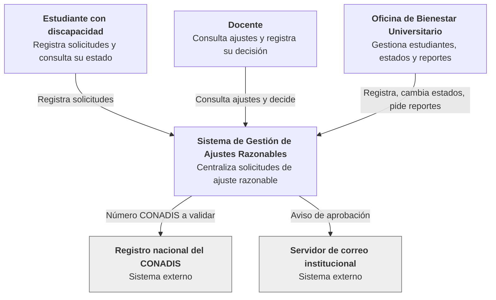
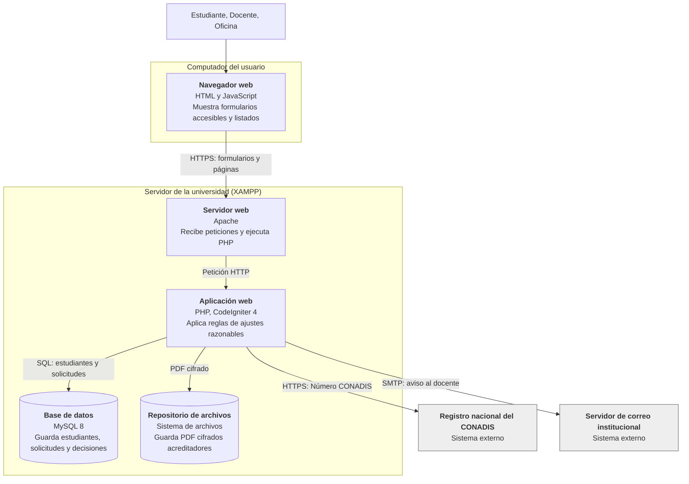
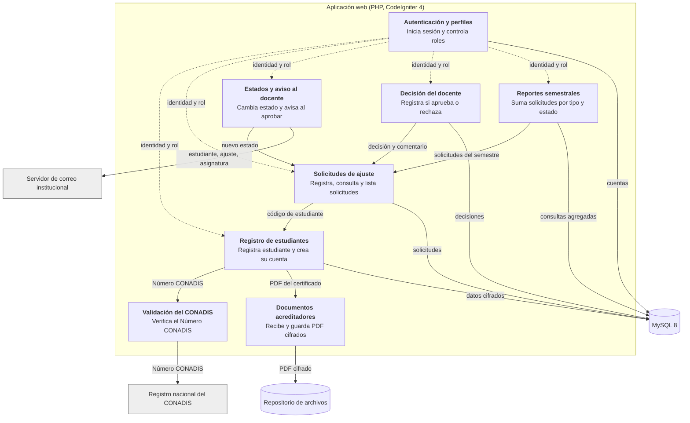
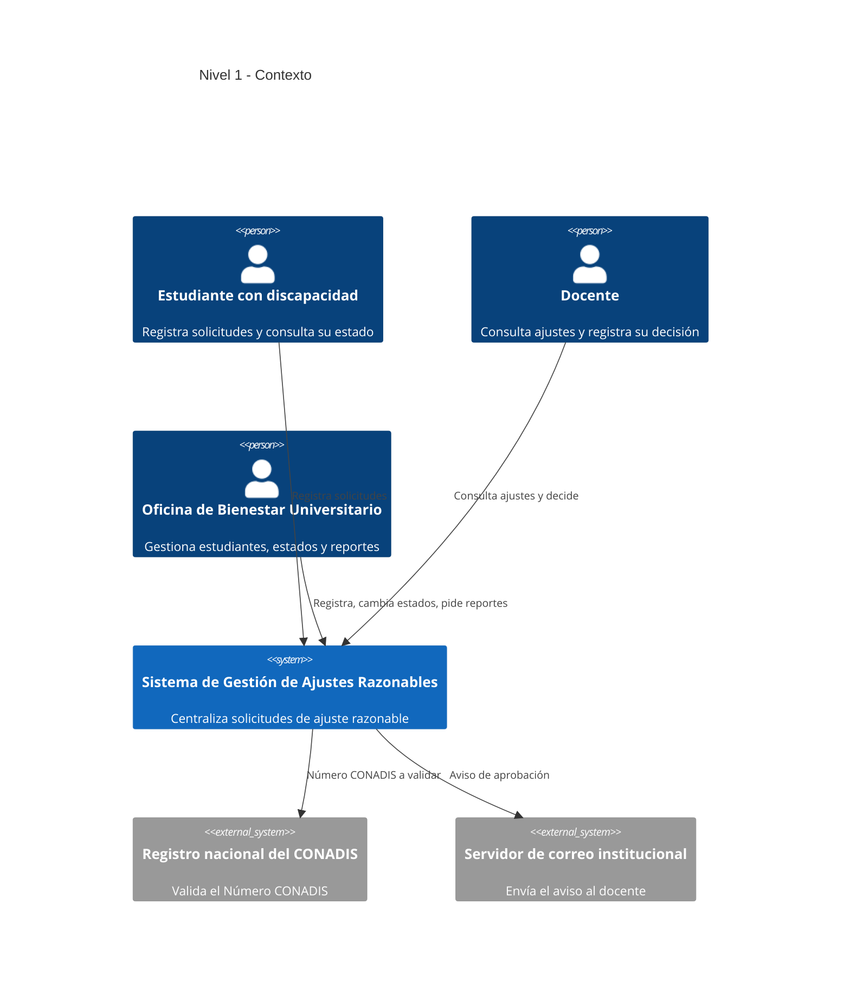
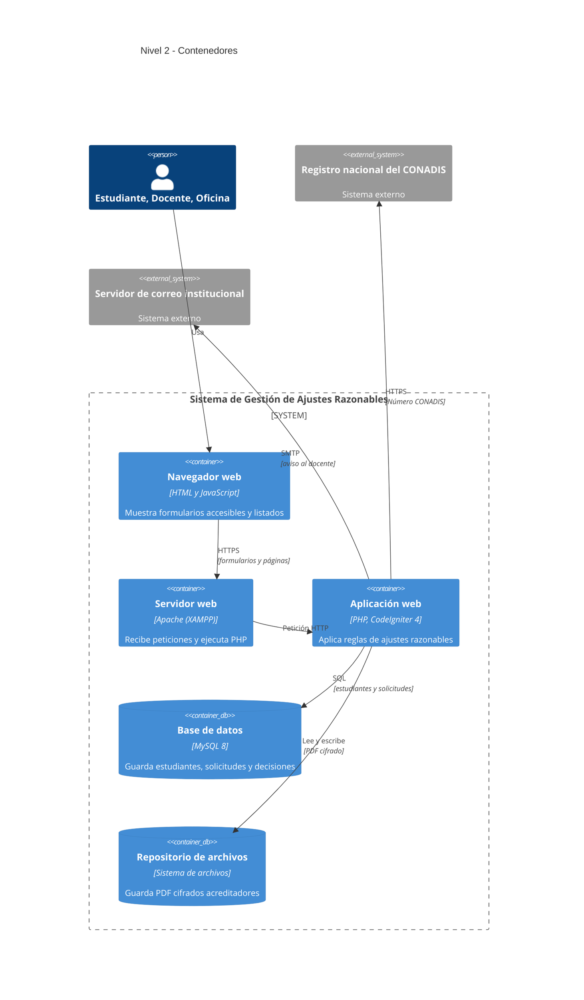
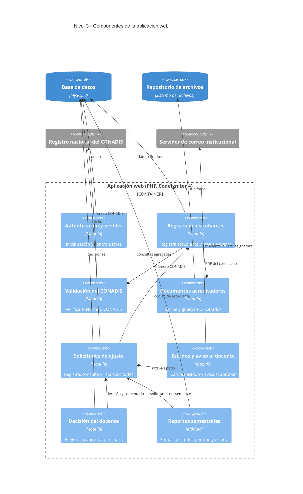

# ADR-002: Modelo C4 de la arquitectura (contexto, contenedores y componentes)

**Estado:** Propuesto

## Contexto

PA-02 recomienda un monolito modular por dominio con HTML generado en servidor, y ADR-001 (PA-03) adopta CodeIgniter 4 sobre PHP, con MySQL 8 y Apache de XAMPP. Falta describir esa decisión de forma visual y trazable, de modo que cada elemento provenga de un requisito de `requirements.md` o de una restricción.

Los drivers de PA-01 que condicionan la forma del modelo son:

- La accesibilidad del formulario (RNF1 a RNF3).
- La confidencialidad por rol de datos sensibles (RNF7 y RNF8, Ley N.° 29733).
- El aislamiento de los servicios externos (CONADIS y correo).
- El plazo con un equipo de cuatro personas.

El sistema no usa servidor MCP ni modelo de lenguaje (DA4), por lo que no se dibujan.

## Decisión

Se documenta la arquitectura con el modelo C4 en tres niveles, en Mermaid: contexto (nivel 1), contenedores (nivel 2) y componentes de la aplicación web (nivel 3). No se incluye el nivel 4 (clases y tablas), que corresponde a `design.md`. Todos los nombres están en español.

## Nivel 1: Contexto

El sistema aparece como una caja única, con tres actores y dos sistemas externos.

## Nivel 2: Contenedores

## Nivel 3: Componentes de la aplicación web

## Alternativa en sintaxis C4 de Mermaid

En la versión C4 se omitieron las flechas de identidad y rol desde "Autenticación y perfiles" para no saturar el diagrama.

### Nivel 1: Contexto

### Nivel 2: Contenedores

### Nivel 3: Componentes

## Decisiones visibles en el diagrama

- **Una sola aplicación web con módulos (PA-02):** los ocho componentes viven dentro de un único contenedor. No hay API aparte ni SPA, coherente con el monolito modular.
- **Repositorio de archivos separado de MySQL:** los PDF cifrados no van en la base. Se traza a RF10 a RF12 y RNF6.
- **Servicios externos aislados en un componente cada uno:** `Validación del CONADIS` y `Estados y aviso al docente` son los únicos que tocan el exterior. Aíslan los fallos de RF8 y RF25.
- **Solo "Estados y aviso" cambia el estado; "Decisión del docente" va aparte:** ambos escriben en `Solicitudes`, pero por componentes distintos. Refleja RF22 y RF38 a RF40 (la decisión no altera el estado) y los controles de RNF7 y RNF8.
- **`Reportes semestrales` solo lee `Solicitudes`:** consulta agregada por semestre (RF31 a RF34, H5). No hay MCP ni modelo de lenguaje dibujados, porque el sistema no los usa (DA4).

## Consecuencias

**Positivas**

- Cada contenedor y componente se traza a un requisito de `requirements.md`.
- Los fallos de CONADIS y correo quedan aislados en un componente cada uno.
- Los módulos pueden reagruparse (por ejemplo, unir "Estados y aviso" con "Decisión del docente") sin afectar el resto.

**Negativas**

- Un solo contenedor de aplicación concentra todas las reglas; si crece, habrá que revisar la modularidad.
- El diagrama omite el nivel 4 (clases y tablas), que debe mantenerse aparte en `design.md`.

**Deuda técnica aceptada**

- Las etiquetas tecnológicas (PHP, CodeIgniter 4, MySQL 8, Apache de XAMPP) vienen de ADR-001 y difieren de la pila del D0 (Python, FastAPI, SQLite). Si se vuelve a esa pila, cambian solo esas etiquetas.
- Los diagramas no se probaron en un renderizador; conviene validarlos en el editor de Mermaid.

## Criterio de reversión

Se revisa este modelo si, antes de la semana 7, ocurre alguna de estas cosas:

- El acceso al registro del CONADIS no se define, lo que obliga a cambiar el componente `Validación del CONADIS`.
- Se confirma que quien aprueba es el docente y no la Oficina, lo que fusiona "Estados y aviso" con "Decisión del docente".
- Se cambia la pila a la del D0, lo que cambia las etiquetas del nivel 2.
